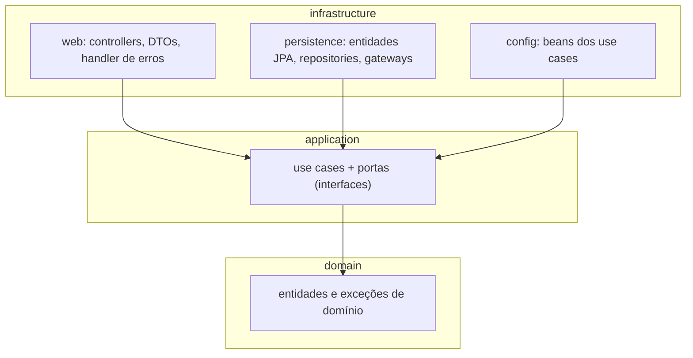
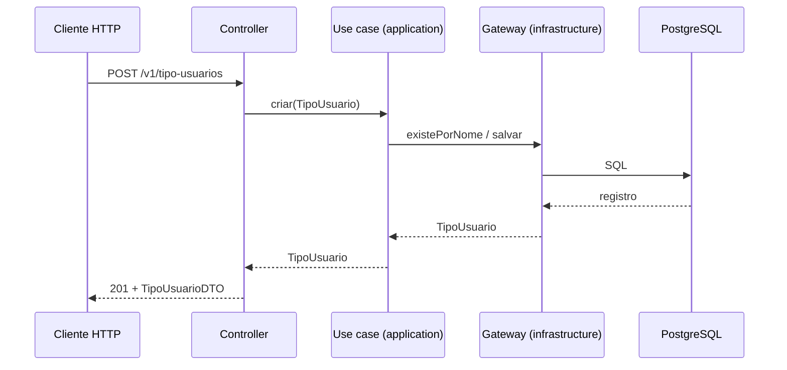
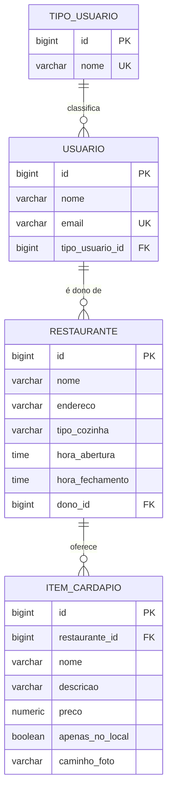

# Sistema de Gestão de Restaurantes — Tech Challenge Fase 2

Back-end em **Java + Spring Boot** para um sistema de gestão compartilhado por um grupo de restaurantes. Projeto do **Tech Challenge – Fase 02** da Pós Tech FIAP (Arquitetura e Desenvolvimento Java), organizado em **Clean Architecture**.

Esta fase entrega o gerenciamento de **tipos de usuário**, o cadastro de **restaurantes** e o cadastro dos **itens do cardápio**.

- **Autor:** Mauricio Borges Florencio
- **Repositório:** https://github.com/fxbricix/clean-arch-fiap
- **Vídeo de apresentação:** 🚧 _link a adicionar_

---

## Sumário

1. [Status do projeto](#status-do-projeto)
2. [Tecnologias](#tecnologias)
3. [Como executar](#como-executar)
4. [API](#api)
5. [Arquitetura](#arquitetura)
6. [Modelo de dados e migrations](#modelo-de-dados-e-migrations)
7. [Testes e cobertura](#testes-e-cobertura)
8. [Decisões de projeto](#decisões-de-projeto)
9. [Collection do Postman](#collection-do-postman)

---

## Status do projeto

| Funcionalidade | Status |
|---|---|
| Infraestrutura (Docker Compose, Flyway, Swagger) | ✅ pronto |
| Cadastro de **tipo de usuário** (CRUD) | ✅ pronto |
| **Usuário** e associação ao tipo de usuário | ✅ pronto |
| Cadastro de **restaurante** (CRUD) | 🚧 planejado |
| Cadastro de **item do cardápio** (CRUD) | 🚧 planejado |
| Collection do Postman | 🚧 planejado |

---

## Tecnologias

| Item | Tecnologia |
|---|---|
| Linguagem | Java 21 |
| Framework | Spring Boot 3.3.5 (Web, Data JPA, Validation) |
| Banco de dados | PostgreSQL 17 |
| Migrations | Flyway 11 |
| Documentação da API | springdoc-openapi (Swagger UI) |
| Build | Maven (com Maven Wrapper) |
| Containers | Docker e Docker Compose |
| Testes | JUnit 5, Mockito, Testcontainers, ArchUnit |
| Cobertura | JaCoCo (mínimo de 80% de linhas) |

---

## Como executar

### Pré-requisitos

- [Docker](https://docs.docker.com/get-docker/) com Docker Compose

Para rodar os testes ou desenvolver fora do container, também são necessários o **JDK 21** e o Docker em execução (os testes de integração usam Testcontainers).

### Subindo tudo com Docker Compose

```bash
git clone https://github.com/fxbricix/clean-arch-fiap.git
cd clean-arch-fiap
docker compose up --build
```

O Compose sobe três serviços, nesta ordem:

1. **`postgres`**: banco PostgreSQL 17, com _healthcheck_.
2. **`flyway`**: aplica as migrations de `database/migrations` e encerra.
3. **`app`**: a aplicação Spring Boot, iniciada somente depois que o banco está saudável e as migrations terminaram com sucesso.

Depois de subir:

| Recurso | URL |
|---|---|
| API | http://localhost:8080 |
| Swagger UI | http://localhost:8080/swagger-ui.html |
| OpenAPI (JSON) | http://localhost:8080/v3/api-docs |
| PostgreSQL | `localhost:5432` (banco `fiap-tech-challenge`, usuário `postgres`, senha `postgres`) |

Para parar:

```bash
docker compose down        # para os containers, mantém os dados
docker compose down -v     # para e apaga o volume: o banco recomeça do zero
```

### Desenvolvimento local (aplicação fora do Docker)

Suba apenas o banco e as migrations e rode a aplicação pelo Maven:

```bash
docker compose up -d postgres flyway
./mvnw spring-boot:run          # Windows: mvnw.cmd spring-boot:run
```

### Variáveis de ambiente

A aplicação lê a conexão do banco destas variáveis (o Compose já as define; os valores abaixo são os padrões para rodar localmente):

| Variável | Padrão |
|---|---|
| `DB_HOST` | `localhost` |
| `DB_PORT` | `5432` |
| `DB_NAME` | `fiap-tech-challenge` |
| `DB_USER` | `postgres` |
| `DB_PASSWORD` | `postgres` |

> **Importante:** o schema é de responsabilidade do Flyway. A aplicação roda com `spring.jpa.hibernate.ddl-auto=validate` e `spring.flyway.enabled=false`; se o schema não bater com as entidades, a aplicação não sobe.

---

## API

Todas as rotas são prefixadas com `/v1`. A documentação interativa está no Swagger UI.

### Tipos de usuário — `/v1/tipo-usuarios`

| Método | Rota | Descrição | Sucesso | Erros possíveis |
|---|---|---|---|---|
| `POST` | `/v1/tipo-usuarios` | Cria um tipo de usuário | `201` | `400`, `409` |
| `GET` | `/v1/tipo-usuarios/{id}` | Busca um tipo pelo id | `200` | `404` |
| `GET` | `/v1/tipo-usuarios/listar` | Lista todos os tipos | `200` | — |
| `PATCH` | `/v1/tipo-usuarios/{id}` | Altera o nome de um tipo | `200` | `400`, `404`, `409` |
| `DELETE` | `/v1/tipo-usuarios/{id}` | Exclui um tipo | `204` | `404`, `409` |

**Regras do campo `nome`:** obrigatório (não pode ser vazio ou só espaços), no máximo 50 caracteres e **único**. Espaços nas pontas são removidos.

Os tipos `CLIENTE` e `DONO_RESTAURANTE` são criados pela migration `V1`.
Esses tipos sistêmicos não podem ser alterados nem excluídos.

**Exemplo: criar**

```bash
curl -X POST http://localhost:8080/v1/tipo-usuarios \
  -H "Content-Type: application/json" \
  -d '{"nome": "GERENTE"}'
```

```json
{
  "id": 3,
  "nome": "GERENTE"
}
```

**Exemplo: alterar**

```bash
curl -X PATCH http://localhost:8080/v1/tipo-usuarios/3 \
  -H "Content-Type: application/json" \
  -d '{"nome": "SUPERVISOR"}'
```

### Respostas de erro

Os erros seguem o formato **RFC 7807** (`application/problem+json`):

| Status | Quando acontece |
|---|---|
| `400 Bad Request` | corpo inválido (campo obrigatório ausente, tamanho excedido) ou regra de domínio violada |
| `404 Not Found` | o recurso pedido não existe |
| `409 Conflict` | nome já cadastrado, tentativa de excluir um tipo em uso por usuários, ou alteração/exclusão de tipo sistêmico |

```json
{
  "type": "about:blank",
  "title": "Not Found",
  "status": 404,
  "detail": "Mensagem descrevendo o erro",
  "instance": "/v1/tipo-usuarios/99"
}
```

### Usuários

| Recurso | Rotas | Campos |
|---|---|---|
| Usuário | `POST /v1/usuarios`, `GET /v1/usuarios/{id}`, `GET /v1/usuarios/listar`, `PUT /v1/usuarios/{usuarioId}/tipo/{tipoUsuarioId}` | nome, e-mail, tipo de usuário |

### Endpoints planejados

| Recurso | Rotas previstas | Campos (conforme o enunciado) |
|---|---|---|
| Restaurante | CRUD em `/v1/restaurantes` | nome, endereço, tipo de cozinha, horário de funcionamento, dono (usuário do tipo `DONO_RESTAURANTE`) |
| Item do cardápio | CRUD em `/v1/restaurantes/{id}/itens` | nome, descrição, preço, disponível apenas no local, caminho da foto |

---

## Arquitetura

O projeto segue a **Clean Architecture** em três camadas. A **regra de dependência** é única: as dependências apontam sempre para dentro.



| Camada | Responsabilidade | Pode depender de |
|---|---|---|
| `domain` | Entidades e regras de negócio puras. Java puro, sem Spring e sem JPA. | nada |
| `application` | Casos de uso e as **portas** (interfaces) que eles precisam: o use case do tipo de usuário e o gateway de persistência. Sem Spring. | `domain` |
| `infrastructure` | Detalhes técnicos e frameworks: controllers REST, DTOs, entidades JPA, repositories, implementação dos gateways, configuração. | `application` e `domain` |

A inversão de dependência acontece nos gateways: a **interface** é definida em `application` e a **implementação** fica em `infrastructure`, então o use case nunca conhece JPA nem o banco.

A regra é verificada automaticamente por testes **ArchUnit**: se `domain` ou `application` passarem a importar Spring, JPA ou `infrastructure`, o build falha.

### Fluxo de uma requisição



### Estrutura de pacotes

```
src/main/java/com/fiap/cleanarchitecture
├── domain
│   ├── entities                 TipoUsuario
│   └── exceptions               DominioException
│
├── application
│   ├── interfaces               ITipoUsuarioUseCase            (porta de entrada)
│   ├── usecases                 TipoUsuarioUseCaseImpl
│   ├── gateways                 ITipoUsuarioGateway            (porta de saída)
│   └── exceptions               ConflitoException, RecursoNaoEncontradoException
│
└── infrastructure
    ├── config                   UseCaseConfig                  (use cases como beans)
    ├── web
    │   ├── controllers          TipoUsuarioController
    │   ├── dtos                 CriarTipoUsuarioDTO, TipoUsuarioDTO
    │   ├── mappers              TipoUsuarioWebMapper           (DTO <-> domínio)
    │   └── exceptions           GlobalExceptionHandler
    └── persistence
        ├── entities             TipoUsuarioEntity              (modelo JPA)
        ├── repository           TipoUsuarioJpaRepository
        ├── mappers              TipoUsuarioPersistenceMapper   (JPA <-> domínio)
        └── gateway              TipoUsuarioGatewayImpl

database/migrations              scripts Flyway (V1 a V4)
src/test                         testes unitários, de integração e de arquitetura
```

---

## Modelo de dados e migrations



| Migration | O que faz |
|---|---|
| `V1__criar_tipo_usuario.sql` | cria `tipo_usuario` e insere `CLIENTE` e `DONO_RESTAURANTE` |
| `V2__criar_usuario.sql` | cria `usuario`, com chave estrangeira para o tipo |
| `V3__criar_tabela_restaurante.sql` | cria `restaurante`, com o dono (usuário) |
| `V4__criar_item_cardapio.sql` | cria `item_cardapio`, ligado ao restaurante |

As migrations ficam em `database/migrations` e são executadas pelo serviço `flyway` do Compose. Depois de aplicada, uma migration **nunca deve ser editada**: crie uma nova versão (`V5`, `V6`...). Em desenvolvimento local, `docker compose down -v` recria o banco do zero.

---

## Testes e cobertura

```bash
./mvnw verify        # roda todos os testes e valida a cobertura (Docker precisa estar rodando)
```

| Tipo | O que cobre | Ferramentas |
|---|---|---|
| **Unitários** | regras do domínio, use cases e gateway, com dependências simuladas | JUnit 5, Mockito |
| **Integração** | API completa (HTTP → use case → banco), com **PostgreSQL real** em container e as migrations reais aplicadas | `@SpringBootTest`, MockMvc, Testcontainers, Flyway |
| **Arquitetura** | a regra de dependência entre as camadas | ArchUnit |

- Os testes de integração compartilham **um único container** PostgreSQL e usam dados únicos por teste, sem apagar tabelas, então um teste não depende de outro nem da ordem de execução.
- As migrations dos testes vêm de `database/migrations`; por isso o Maven deve ser executado na **raiz do projeto**.
- O **JaCoCo** exige no mínimo **80% de cobertura de linhas**: abaixo disso o `mvn verify` falha.
- Relatório de cobertura: `target/site/jacoco/index.html`.

---

## Decisões de projeto

| Decisão | Motivo |
|---|---|
| **Três camadas** (`domain`, `application`, `infrastructure`), com `infrastructure` dividida em `web` e `persistence` | atende à estrutura pedida no enunciado e mantém controllers e persistência como adaptadores independentes |
| **Sem presenter:** o use case devolve o resultado e o controller o converte em DTO | mais simples para uma API REST; um presenter só compensaria com vários formatos de saída |
| **A entidade de domínio é a entrada e a saída do use case** | evita uma camada extra de objetos de entrada e saída; o custo é o controller conhecer o domínio |
| **Entidades JPA separadas das entidades de domínio**, com mappers | o domínio não conhece JPA, e o modelo de persistência pode mudar sem afetar as regras |
| **Use cases sem anotações do Spring**, registrados como beans em `UseCaseConfig` | mantém `application` livre de framework |
| **Flyway como serviço do Compose**, desligado na aplicação e usado somente nos testes | separa o ciclo de vida do schema do da aplicação; a aplicação só valida o schema (`ddl-auto=validate`) |
| **Erros traduzidos em um único ponto** (`GlobalExceptionHandler`) | o use case não sabe o que é um status HTTP; só lança exceções de domínio ou de aplicação |
| **Unicidade garantida em duas camadas:** verificação no use case e `UNIQUE` no banco | resposta `409` amigável no caso comum e integridade garantida mesmo sob concorrência |
| **Testes de integração com PostgreSQL real** (Testcontainers) em vez de banco em memória | valida as migrations reais e o comportamento do banco de produção |

---

## Collection do Postman

🚧 _A collection será adicionada em `postman/` com o fluxo completo: criar tipo → criar usuário → associar tipo → criar restaurante → cadastrar item do cardápio._

Enquanto isso, todos os endpoints podem ser testados pelo Swagger UI: http://localhost:8080/swagger-ui.html